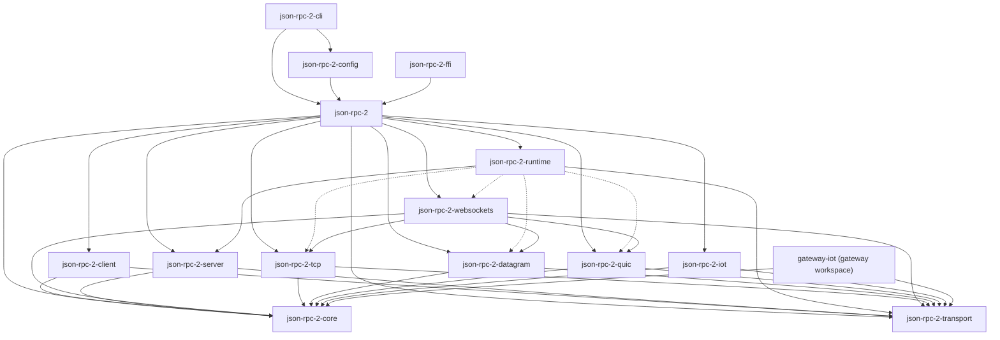
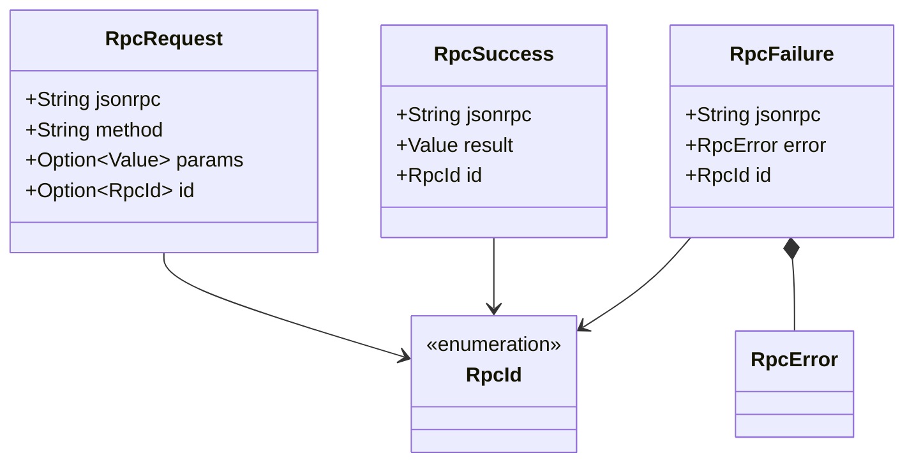
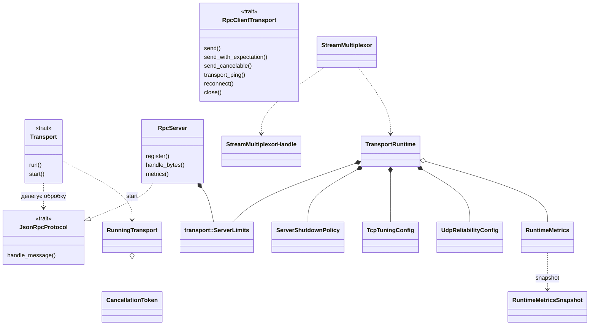
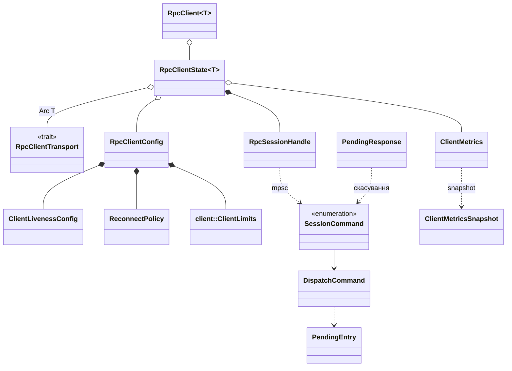
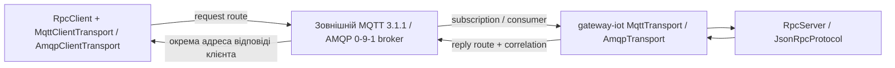
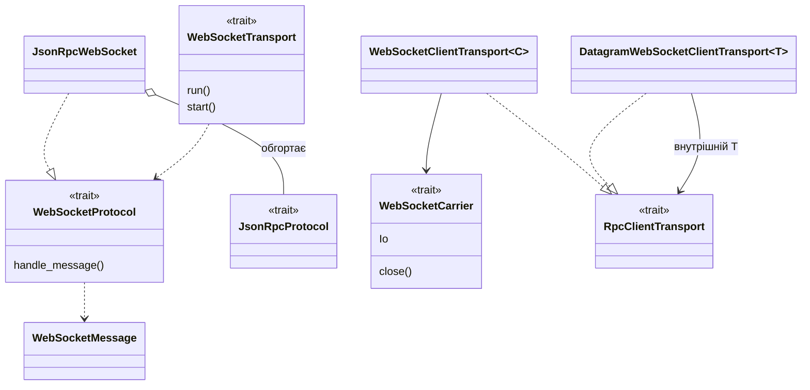
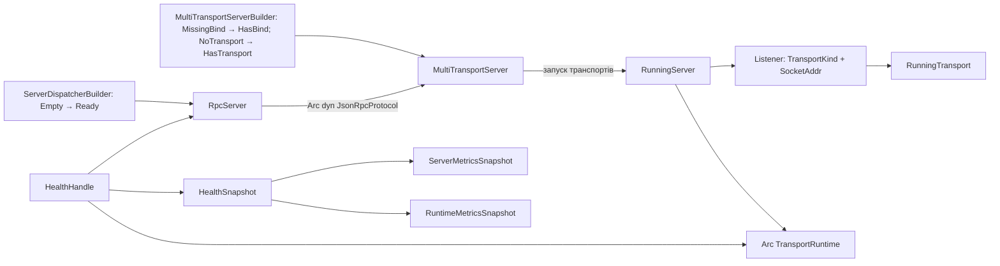

# Схема об'єктів проєкту JSON_RPC_2

Схема відображає поточну структуру Rust workspace після перенесення
реалізацій транспортів у спеціалізовані крейти. Діаграми записані у Mermaid.
Наведено основні об'єкти, контракти, реалізації та зв'язки між ними,
а не кожну допоміжну функцію чи тестовий тип.

## 1. Залежності крейтів

Стрілка `A --> B` означає, що крейт A залежить від B.
Пунктирні стрілки позначають опціональні залежності runtime, керовані Cargo features.
Зовнішні бібліотеки на цій діаграмі не показані.



**Головний інваріант:** `json-rpc-2-core` містить wire/protocol типи;
`json-rpc-2-transport` — клієнтські та серверні transport-контракти,
мережеві tuning-параметри і спільні runtime-примітиви. Реалізації сімейств
залежать від обох крейтів, але не від dispatcher чи клієнта.
`json-rpc-2-server` містить JSON-RPC dispatcher, а `json-rpc-2-runtime` —
orchestration, health та інтеграцію dispatcher з транспортами.

## 2. Об'єкти протоколу JSON-RPC 2.0

Джерело: `json-rpc-2-core/src/lib.rs`.
`Value` нижче означає `serde_json::Value`.



Запит без поля `id` є notification: сервер обробляє його без JSON-RPC
відповіді. Batch передається як JSON-масив; клієнтський API представляє
його елементи через `BatchRequest`, а результати — через `BatchResponse`.

## 3. Транспортні контракти та серверний runtime

Джерела:
`json-rpc-2-transport/src/client_transport.rs`,
`json-rpc-2-transport/src/server_transport.rs`,
`json-rpc-2-server/src/lib.rs`.

У Rust абстракції реалізовані через traits, а не абстрактні класи.
Зв'язок `..|>` означає реалізацію trait; `*--` — належність до об'єкта;
`o--` — спільне володіння або збережене посилання.



Конкретний транспорт відповідає за framing, доставку та завершення
з'єднання. `JsonRpcProtocol` отримує повне повідомлення і повертає
`Option<Bytes>`. `RpcServer` реалізує JSON-RPC parsing, dispatch,
batch-обробку та формування помилок незалежно від транспорту.
`RuntimeMetrics` зберігає атомарні лічильники приватно та надає snapshot і
типізовані операції обліку сесій, потоків і reconnect.

## 4. Клієнтські об'єкти та actor/session

Джерело: `json-rpc-2-client/src/lib.rs`.
Внутрішні об'єкти сесії показані для пояснення runtime-моделі;
вони не є окремим публічним API.



`client::ClientLimits` обмежує вихідну чергу та кількість запитів
у польоті. `transport::ServerLimits` задає серверні ліміти з'єднань і
паралельних запитів. `TransportLimits` лишається сумісним alias.

## 5. Реалізації транспортів

Кожен рядок представляє реалізацію клієнта й, де доступно в цьому workspace,
серверний відповідник. Клієнти виконують контракт `RpcClientTransport`,
серверні non-WebSocket реалізації — контракт `Transport`. Для IoT серверна
реалізація вказує на адаптер у зовнішньому `gateway-iot`.

| Крейт | Протокол / носій | Клієнтський об'єкт | Серверний об'єкт |
|---|---|---|---|
| `json-rpc-2-tcp` | TCP | `TcpClientTransport` | `TcpTransport` |
| `json-rpc-2-tcp` | HTTP/1.1 | `Http1ClientTransport` | `Http1Transport` |
| `json-rpc-2-datagram` | Reliable UDP | `UdpClientTransport` | `UdpTransport` |
| `json-rpc-2-datagram` | RTP/RTCP | `RtpClientTransport` | `RtpTransport` |
| `json-rpc-2-datagram` | RUDP | `RudpClientTransport` | `RudpTransport` |
| `json-rpc-2-datagram` | SRT (libsrt) | `SrtClientTransport` | `SrtTransport` |
| `json-rpc-2-datagram` | UDP-Lite | `UdpLiteClientTransport` | `UdpLiteTransport` |
| `json-rpc-2-datagram` | DCCP | `DccpClientTransport` | `DccpTransport` |
| `json-rpc-2-datagram` | SCTP | `SctpClientTransport` | `SctpTransport` |
| `json-rpc-2-quic` | QUIC | `QuicClientTransport` | `QuicTransport` |
| `json-rpc-2-quic` | HTTP/3 | `Http3ClientTransport` | `Http3Transport` |
| `json-rpc-2-iot` | MQTT | `MqttClientTransport` | `gateway-iot` |
| `json-rpc-2-iot` | CoAP | `CoapClientTransport` | `gateway-iot` |
| `json-rpc-2-iot` | AMQP | `AmqpClientTransport` | `gateway-iot` |

Клієнтські файли розташовані у
`<family-crate>/src/client/transports/<protocol>.rs`; IoT server adapters
розташовані у `gateway-iot/src/server/transports/`.
Доступність залежить від Cargo features та підтримки ОС; зокрема,
UDP-Lite обмежений Linux/Android.

Спільні wire-об'єкти містяться у `json-rpc-2-core`:

| Модуль | Основні об'єкти |
|---|---|
| `udp_reliable.rs` | `UdpReliabilityConfig`, `ReliableUdpPacket`, `ReliableUdpPacketKind` |
| `rtp.rs` | `RtpPacket`, `RtpPacketKind`, `RtcpControlPacket`, `RtcpControlPacketKind` |
| `rudp.rs` | `RudpPacket`, `RudpPacketKind` |
| `srt.rs` | `SrtConfig`; старі packet/crypto helpers не використовуються native SRT |
| `udp_lite.rs` | `UdpLiteConfig` |
| `mqtt.rs` | `MqttPacket`, `MqttPacketKind` — legacy codec, не broker transport |
| `coap.rs` | `CoapMessage`, `CoapMessageType` |
| `amqp.rs` | `AmqpFrame`, `AmqpMessageKind` — legacy codec, не broker transport |
| `websocket.rs` | `WebSocketMessage`, `WebSocketFrame`, `WebSocketFrameKind`, `WebSocketProtocol` |

Наявність адаптера не означає повної реалізації всього зовнішнього
стандарту. SRT використовує native libsrt, а MQTT 3.1.1 / AMQP 0-9-1 —
клієнтські бібліотеки зовнішніх брокерів. Datagram/broker WebSocket
використовує власну оболонку повідомлень, не RFC 6455 поверх UDP
і не MQTT-over-WebSocket.

### Брокерна топологія MQTT / AMQP



Клієнт і сервіс під'єднуються до брокера назовні. `MqttConfig` /
`AmqpConfig` задають broker endpoint та application route; локальний
`TcpListener` не є брокером. `GatewayIotIngress` у `gateway-iot` керує
життєвим циклом цих підписок/consumer; `MultiTransportServer` не містить
IoT server orchestration.

## 6. Окремий рівень WebSocket

Контракт повідомлень `WebSocketProtocol` міститься в core.
Сесії, контракти носіїв та конкретні адаптери — у `json-rpc-2-websockets`.



Потокові клієнтські спеціалізації:

| Публічний тип | Носій `C` |
|---|---|
| `TcpWebSocketClientTransport` | `TcpWebSocketCarrier` |
| `Http1WebSocketClientTransport` | `Http1Upgrade` |
| `QuicWebSocketClientTransport` | `QuicWebSocketCarrier` |
| `Http3WebSocketClientTransport` | `Http3Connect` |

Ці чотири типи є aliases для `WebSocketClientTransport<C>`.
Для UDP, RTP, RUDP, SRT, UDP-Lite, DCCP, SCTP, MQTT, CoAP та AMQP
є окремі типи `<Carrier>WebSocketClientTransport`.
Серверні типи в цьому workspace мають назви `<Carrier>WebSocketTransport`
і реалізують `WebSocketTransport`. IoT server variants реалізовані окремо у
`gateway-iot`.

Файли адаптерів: `json-rpc-2-websockets/src/{client,server}/transports/`.
Публічний шлях `client::transports::websocket` або
`server::transports::websocket` може бути реекспортом і не обов'язково
відповідає фізичній вкладеній директорії.

## 7. Збирання та життєвий цикл сервера

Джерела: `json-rpc-2-server/src/lib.rs`,
`json-rpc-2-runtime/src/multi.rs`.



`MultiTransportServer` зберігає адреси, порти, опціональну TLS identity
та транспортні налаштування. `RunningServer` утримує запущені listeners
і спільний runtime. Typestate-маркери обмежують допустимі переходи
builder на рівні типів.

## 8. Конфігурація, FFI та опис можливостей

| Рівень | Об'єкти та відповідальність |
|---|---|
| Transport | `TransportCapabilities`, `TransportCapabilitySet`, `TransportMultiplexing`, `TransportSecurity`, `TransportSocket` — опис можливостей транспорту |
| Transport | `TcpTuningConfig`, `TcpCongestionControl` — параметри TCP, зокрема вибір congestion control |
| Runtime | `TransportKind` — вибір реалізації та її можливостей |
| Config | `EnvFiles`, `ScriptProfiles`, `RuntimeOptions`, `CommandConfig` — читання та перевірка конфігурації запуску |
| CLI | Вибір режиму, створення конфігурації та запуск клієнта або сервера |
| FFI | `RpcClient`, `FfiTransportKind`, `ConnectOptions`, транспортні `*ConnectOptions`, `FfiError` — зовнішній API через UniFFI |
| Facade | `json-rpc-2` — реекспорти клієнта, dispatcher, runtime, core, transport-контрактів та сімейств |

FFI `RpcClient` та generic `json_rpc_2_client::RpcClient<T>` —
різні типи: перший є зовнішньою обгорткою над клієнтською реалізацією.

## 9. Прохід одного JSON-RPC запиту

```mermaid
sequenceDiagram
    participant App as Застосунок
    participant Client as RpcClient
    participant Actor as Сесійний actor
    participant CT as RpcClientTransport
    participant ST as Серверний транспорт
    participant RPC as JsonRpcProtocol / RpcServer

    App->>Client: call(method, params)
    Client->>Actor: DispatchCommand через bounded mpsc
    Actor->>CT: send_cancelable(payload, expects_response, cancel)
    CT->>ST: Повідомлення через мережевий носій
    ST->>RPC: handle_message(повне повідомлення)
    RPC->>RPC: Валідація, dispatch, виконання handler
    alt Запит з id
        RPC-->>ST: Some(Bytes)
        ST-->>CT: Відповідь через носій
        CT-->>Actor: Результат транспорту
        Actor-->>Client: Результат через oneshot
        Client-->>App: Результат або помилка
    else Notification
        RPC-->>ST: None
        Note over CT,ST: JSON-RPC відповідь не очікується
    end
```

Для WebSocket між серверним носієм і `JsonRpcProtocol` додається
`JsonRpcWebSocket`: він перетворює `WebSocketMessage` на байти JSON-RPC
і формує відповідне WebSocket-повідомлення з результату.
